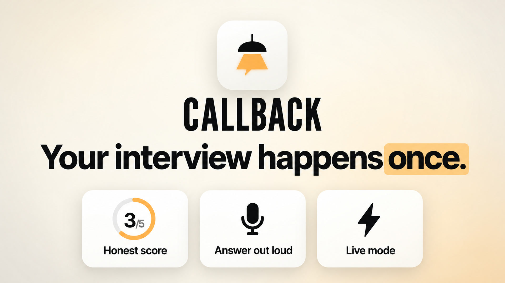
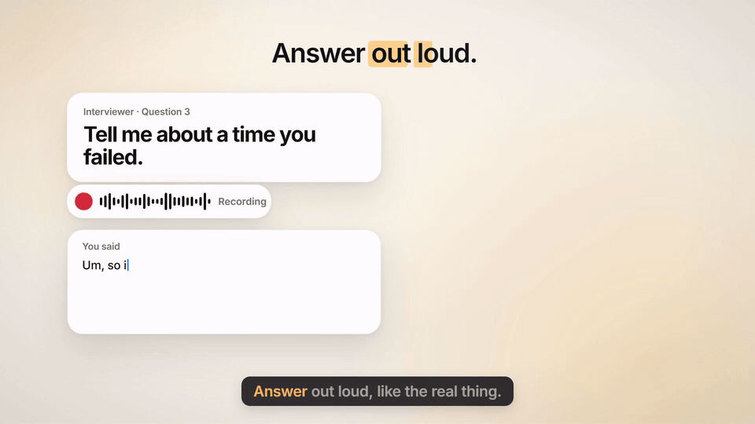
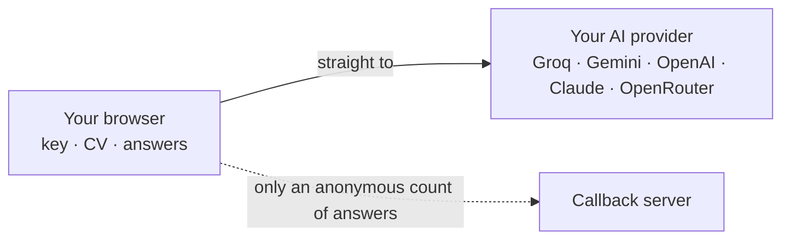
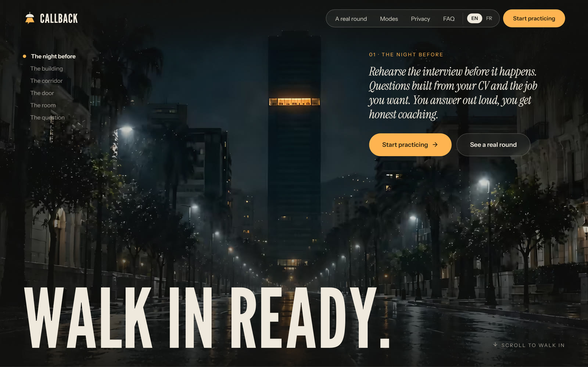
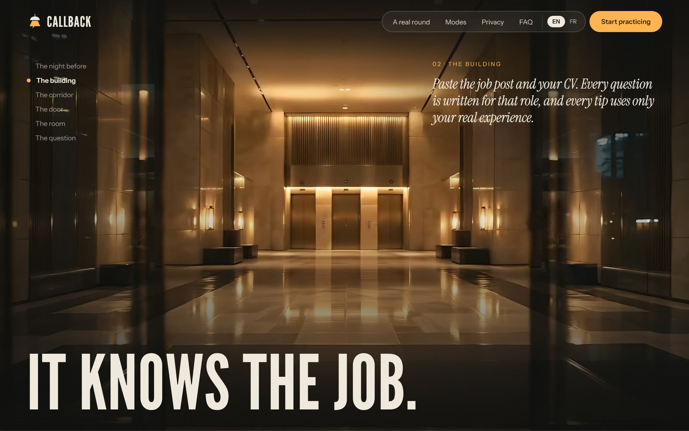
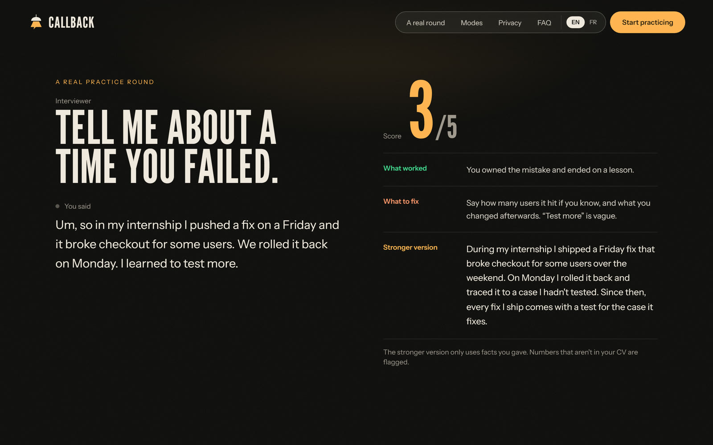
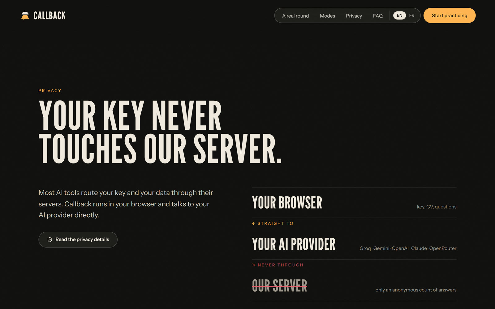
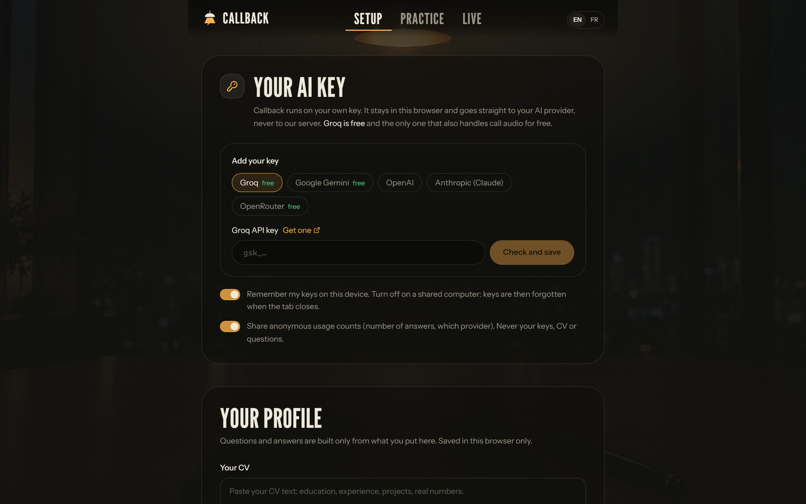
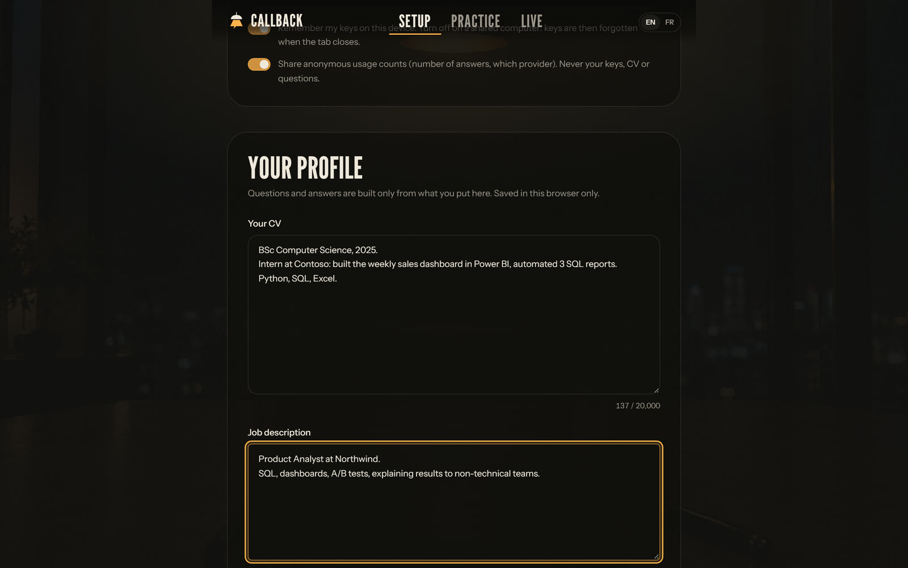

<h1 align="center">Callback</h1>

<b>Rehearse the interview before you walk in.</b> 
A free AI interview practice room that runs in your browser.

  <a href="https://interview-copilot-coach.vercel.app"><b>Open the live app</b></a> &nbsp;·&nbsp;
  <a href="https://github.com/ilyasdaoudrma/callback/raw/main/assets/demo.mp4"><b>Watch the 60-second demo</b></a>

> **This repository is the project page, not the source.** Callback's code is private. Here you'll find what it does, how it's built and what it looks like. The app itself is live and free to use.

## What it does

| | |
|---|---|
| **Questions for your exact role** | Paste the job post and your CV. Every question is written for that role, and every tip uses only your real experience. |
| **Answer out loud** | Answer by voice, like the real thing (or type). |
| **Honest feedback** | A score out of 5, what worked, what to fix, and a stronger version of your answer. |
| **No invented achievements** | The stronger version only uses facts you gave. A number that isn't in your CV gets flagged instead of made up. |
| **Live mode** | During a call, it hears the interviewer's question and suggests an answer from your own CV in about a second. Meant only for interviews where notes or assistance are allowed. |
| **Your language** | Interface in English and French. Questions, answers and feedback also work in Arabic. |

## Private by design

Callback runs on **your own AI key** (Groq's free tier is enough for daily practice). Your key, your CV and your answers go **straight from your browser to the AI provider you choose**. They never pass through Callback's server.

- Keys live in local storage, or session storage if you turn off "Remember my keys".
- You can add backup keys from other providers. They're used if the main one fails.
- Anonymous usage counts (number of answers, provider type) can be switched off. No key, CV, question or answer text is ever sent.

## Screens

<table>
  <tr>
    <td width="50%"></td>
    <td width="50%"></td>
  </tr>
  <tr>
    <td></td>
    <td></td>
  </tr>
  <tr>
    <td></td>
    <td></td>
  </tr>
</table>

## How it's built

| Layer | |
|---|---|
| **App** | Next.js 16 · React 19 · TypeScript · Tailwind CSS v4 |
| **Motion** | GSAP · Motion · canvas frame-scrubbing |
| **AI** | Bring-your-own-key clients for Groq, Google Gemini, OpenAI, Anthropic and OpenRouter, called directly from the browser |
| **Speech** | Web Speech API for the microphone · Groq / OpenAI transcription for call audio |
| **Data** | Neon Postgres, only for anonymous usage counts |
| **Quality** | 72 unit tests (Vitest) · Playwright visual and performance QA · EN/FR i18n |
| **Hosting** | Vercel |

**The landing film.** The page is a scroll-driven walk into the interview room: night street, lobby, corridor, door, room, the seat, then the question. I generated five AI video clips (Seedance) chained on six storyboard frames, so each clip starts on the previous one's last frame. I retimed them to a constant camera speed with optical flow, upscaled them 4× locally with Real-ESRGAN, and exported 170 AVIF frames (4.2 MB on desktop, 1.45 MB on phones) that the page scrubs on a canvas as you scroll. Chapter titles assemble letter by letter and burst apart as you scroll past.

**The launch video.** Built in Remotion with an ElevenLabs voice-over, burned-in subtitles timed to the voice, and an original score generated in code.

## Status

Live and free: **[interview-copilot-coach.vercel.app](https://interview-copilot-coach.vercel.app)**. Feedback is welcome in the issues of this repo.

---

Designed and built by **[Ilyas Daoud](https://github.com/ilyasdaoudrma)**.
© 2026 Ilyas Daoud. All rights reserved. The images and video in this repository may not be reused without permission.
